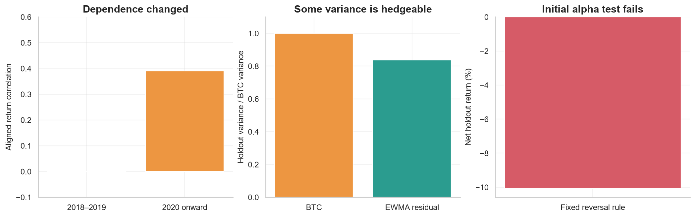

# Bitcoin / Nasdaq Research Lab

A notebook-first lab for testing whether Bitcoin-specific mean reversion survives a changing Nasdaq hedge, trading delays, and realistic costs. Start with [00 · Research map](notebooks/00_research_map.ipynb) and follow the numbered notebooks.

**Initial pass:** 2,225 synchronized sessions, January 2018–November 2026. Correlation strengthened after 2020 and the baseline hedge removed about 16% of holdout variance. The fixed reversal rule lost 10.1% after costs in the 2024-onward holdout. Useful hedging did not establish profitable mean reversion. See [07 · Research review](notebooks/07_research_review.ipynb) and the [research log](docs/research_log.md).



## Quick start

Python 3.12 and [uv](https://docs.astral.sh/uv/) are recommended. From this folder:

```powershell
uv sync --locked
uv run python scripts/fetch_data.py
uv run python scripts/run_research.py
uv run jupyter lab
```

In Jupyter, choose the project's `.venv` interpreter. For VS Code, select `.venv/Scripts/python.exe`. The environment includes a portable `python3` kernel; no global kernel registration is required.

The committed notebooks already contain outputs from the initial pass. To rerun everything in fresh kernels and produce local HTML copies:

```powershell
uv run python scripts/execute_notebooks.py
```

HTML files appear in `reports/html/`. To run one notebook, use `--pattern '03*.ipynb'`. Notebooks remain the editable source; there is no generator that overwrites your edits. After changing assumptions, rerun `scripts/run_research.py` before the notebooks. A changed data configuration also requires `scripts/fetch_data.py`.

## Research sequence

| Notebook | Question |
| --- | --- |
| [00 · Research map](notebooks/00_research_map.ipynb) | What are we testing, and what would falsify it? |
| [01 · Data quality](notebooks/01_data_quality.ipynb) | Do BTC and QQQ returns cover the same intervals? |
| [02 · Correlation regimes](notebooks/02_correlation_regimes.ipynb) | How does dependence change over time and in stress? |
| [03 · Dynamic hedging](notebooks/03_dynamic_hedging.ipynb) | Which causal beta forecast removes the most risk? |
| [04 · Mean reversion](notebooks/04_mean_reversion.ipynb) | Is there evidence of a predictable residual process? |
| [05 · Walk-forward](notebooks/05_walk_forward.ipynb) | Does the fixed rule survive delays, costs, and holdouts? |
| [06 · Hedge sizing and stress](notebooks/06_hedge_sizing_and_stress.ipynb) | How does a return beta translate into units and risks? |
| [07 · Research review](notebooks/07_research_review.ipynb) | What did the first pass establish, and what comes next? |

## Layout

```text
configs/           Versioned assumptions and sample boundaries
data/raw/          Local provider downloads and retrieval manifests (ignored)
data/processed/    Aligned prices and audit tables (ignored)
docs/              Methodology, sources, and research decisions
notebooks/         Ordered, self-contained research narratives and figures
reports/figures/   Selected portable figures
reports/tables/    Reproducible research summaries
scripts/           Fetch data, execute notebooks, and produce research outputs
src/btc_nasdaq/    Reusable data, estimation, signals, simulation, and plotting code
tests/             Timing, estimator, accounting, and data-quality checks
```

The organization follows [Cookiecutter Data Science](https://cookiecutter-data-science.drivendata.org/), with two-digit notebook names and a small importable package, informed by the notebook progression in [Machine Learning for Trading](https://github.com/stefan-jansen/machine-learning-for-trading). Notebook files are the editable research source; calculations that need testing live in `src/`.

## Research contract

- BTC-USD spot from Coinbase and QQQ from Yahoo Finance via yfinance. QQQ is an investable Nasdaq-100 proxy, not the Nasdaq Composite or a futures series.
- Match BTC's last completed hourly candle to each actual Nasdaq session close, including DST and early closes. Never forward-fill missing market observations.
- Use simple returns for return-beta hedges and P&L. Keep return regression separate from log-price cointegration.
- Estimate causally. A signal observed after close `t` executes at close `t+1` and first earns the return ending at `t+2`.
- Test hedge quality separately from alpha. Lower residual volatility is not evidence that a residual price level mean reverts.
- Keep raw vendor data out of Git. Commit code, assumptions, selected figures, and executed research notebooks; a source manifest records provenance and hashes locally.

This is a research implementation, not a live trading system. Hedge beta is conditional and uncertain; crypto-specific jumps, other factors, weekend gaps, financing, and instrument basis remain.

See the [methodology](docs/methodology.md), [source ledger](docs/sources.md), and [research log](docs/research_log.md). No API keys are needed. Downloads are resumable; upstream data may be revised, and raw history is intentionally excluded from this public repository.

## Development checks

```powershell
uv run ruff check src scripts tests
uv run pytest
uv run python scripts/validate_notebooks.py
```

CI runs offline code and notebook-structure checks. Local notebook execution uses the real cached sample; synthetic data is confined to tests. The dependencies are locked in `uv.lock`.
